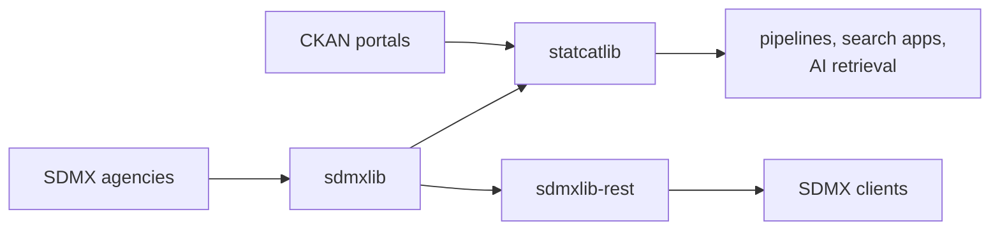

  

## StatCat Suite

Python libraries for statistical and open data catalogs. The suite reads SDMX
structures and observations from the agencies that publish them, adds DCAT-AP
catalog records over them, and serves the result as an SDMX-REST service.
Every library runs embedded: the store is a DuckDB file, observations are
Parquet under DuckLake, and search is a LanceDB directory, so no database
server is involved.

**Documentation:** <https://statcat-suite.github.io/>

| Project | What it does | Install |
|---|---|---|
| [**sdmxlib**](https://github.com/StatCat-Suite/sdmxlib)  | SDMX structures, reference metadata and observation data, from REST, files or a local DuckDB store | `uv add sdmxlib` |
| [**statcatlib**](https://github.com/StatCat-Suite/statcatlib)  | A queryable catalog over DCAT-AP, StatDCAT-AP, CKAN and SDMX: full-text, semantic and structural search | `uv add statcatlib` |
| [**sdmxlib-rest**](https://github.com/StatCat-Suite/sdmxlib-rest)  | An SDMX-REST HTTP service over an sdmxlib store | `uv add sdmxlib-rest` |

`pip install <project>` works too.

statcatlib and sdmxlib-rest each build on sdmxlib; sdmxlib depends on neither.

The libraries are written extensively with AI assistance (Claude Code). Users
who are not comfortable with AI-generated code should take that into account
before adopting them.

All projects are licensed under Apache-2.0.
